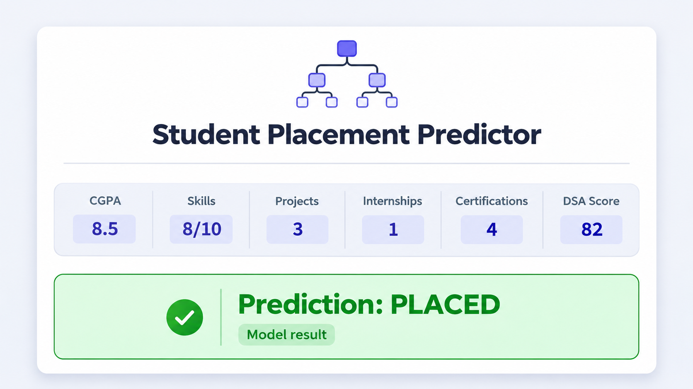

# Student Placement Prediction Model

> Can a student's academic profile and practical experience provide an early signal of placement readiness? This project answers that question with a simple, interpretable machine-learning classifier.

## Problem

Students, mentors, and placement teams often need a quick, consistent way to assess placement readiness. Looking at one metric alone—such as CGPA—misses important context: practical skills, projects, internships, certifications, and data-structures-and-algorithms (DSA) performance also matter.

This project frames the task as a binary classification problem:

- **1 — Placed**
- **0 — Not placed**

The model uses the following inputs while deliberately excluding personal identifiers such as name and roll number:

| Feature | Description |
| --- | --- |
| `CGPA` | Academic performance |
| `Skills` | Skills rating |
| `Projects` | Number of completed projects |
| `Internships` | Internship experience |
| `Certifications` | Relevant certifications |
| `DSA_Score` | Data structures and algorithms score |

## Solution

The notebook builds a small student dataset, separates the features from the `Placed` target, and trains a scikit-learn `DecisionTreeClassifier`.

1. Create a pandas DataFrame containing 30 sample student records.
2. Split the data into training (80%) and test (20%) sets using a fixed random seed.
3. Train a decision-tree classifier on the six placement-related features.
4. Evaluate predictions with accuracy score.
5. Submit a new student's profile to receive either **PLACED** or **NOT PLACED**.

The saved notebook run reports **83.33%** accuracy on its six-record test split. Because the dataset is intentionally small and illustrative, this score demonstrates the workflow only—it is not a deployment-ready measure of real-world placement performance.

### Prediction example

The following screen illustrates the kind of input and result the model can present. The notebook itself includes a programmatic example and prints the final label.



For example, a profile with CGPA **8.5**, skills **8/10**, **3** projects, **1** internship, **4** certifications, and a DSA score of **82** would be passed to the trained classifier and returned as one of the two placement labels.

## Run the project

```bash
python -m venv .venv
.venv\\Scripts\\activate  # Windows PowerShell
pip install pandas scikit-learn jupyter
jupyter notebook Prediction.ipynb
```

Run the notebook cells from top to bottom. The last cells define a `new_student` DataFrame and call `model.predict(new_student)`.

## Future upgrades

This notebook is a foundation that can grow into a more reliable placement-support tool:

- **Use real, consented historical data:** collect larger, representative data across departments, graduation years, and hiring outcomes.
- **Improve validation:** use cross-validation, holdout test sets, and precision/recall, F1, ROC-AUC, and calibration metrics—not accuracy alone.
- **Compare models:** benchmark logistic regression, random forest, gradient boosting, and tuned decision trees with reproducible pipelines.
- **Add responsible-AI checks:** audit feature quality and subgroup performance; avoid using protected or proxy attributes; document limitations and obtain appropriate consent.
- **Explain predictions:** surface decision paths or SHAP-style feature explanations so students receive actionable guidance rather than a bare label.
- **Build a usable app:** expose the trained model through a Streamlit or Flask interface with input validation, probability scores, and personalized improvement suggestions.
- **Productionize safely:** version datasets and models, monitor drift and performance, log feedback, and retrain only after review.

## Tech stack

- Python
- pandas
- scikit-learn
- Jupyter Notebook

## Note

This is an educational project. A placement prediction should support mentoring and planning, never replace fair human judgment or make high-stakes decisions on its own.
